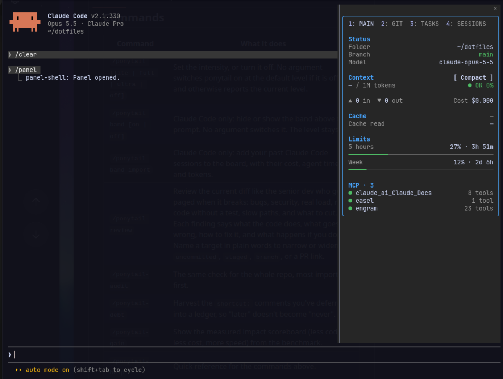
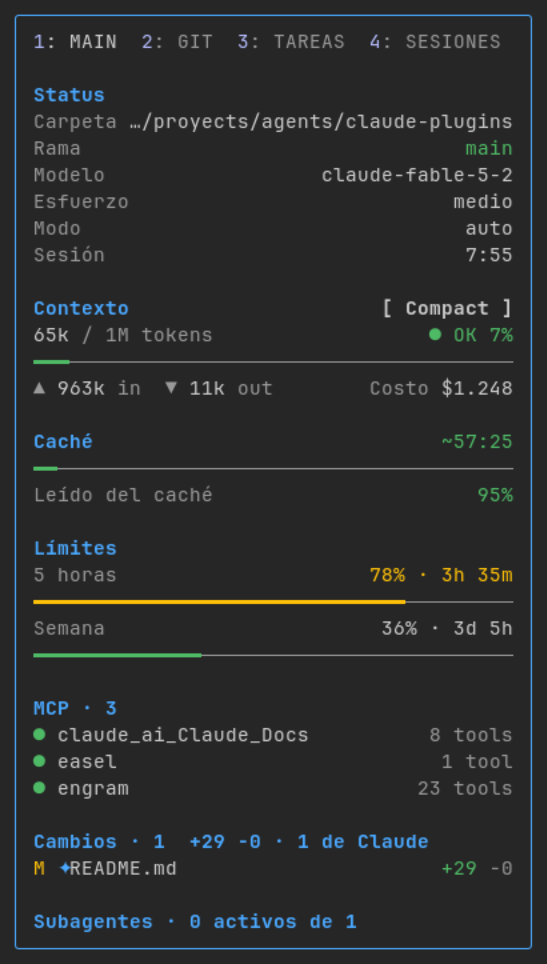
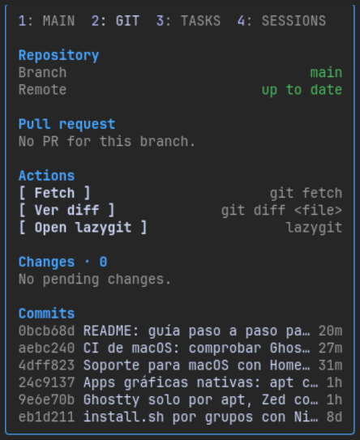
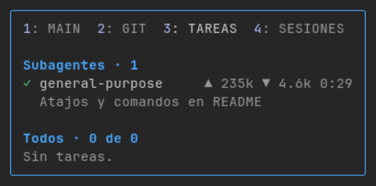
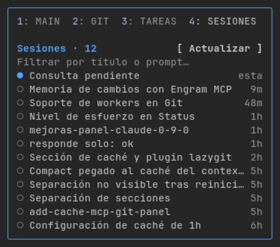

# claude-plugins

**English** · [Español](docs/README.es.md)

My personal marketplace of plugins for Claude Code.

Note: the panel's interface is in Spanish. Tab, section and button names are kept as they appear on screen, with a short English gloss the first time they show up.

This is how `panel-shell` looks when you open Claude Code: the panel sits to the right of the conversation.



The detail of each of its four tabs:

<table>
  <tr><th>MAIN</th><th>GIT</th><th>TAREAS</th><th>SESIONES</th></tr>
  <tr>
    <td valign="top"></td>
    <td valign="top"></td>
    <td valign="top"></td>
    <td valign="top"></td>
  </tr>
</table>

## Install

### Option A: in one step

From the shell:

```bash
claude plugin install panel-shell --marketplace jonico22/claude-plugins
```

If the marketplace isn't added yet, this command adds it first (in the user settings) and then installs the plugin.

You can also do it from the prompt of a Claude Code session:

```
/plugin install panel-shell --marketplace jonico22/claude-plugins
```

Answer `y` to add the marketplace and pick the scope.

### Option B: in two steps

```bash
# 1. Add the marketplace (it is registered as jonico22-plugins)
claude plugin marketplace add jonico22/claude-plugins

# 2. Install the plugin from that marketplace
claude plugin install panel-shell@jonico22-plugins
```

### Scope

By default it installs with `user` scope, so you get it in all your sessions. To limit it to one project, use `--scope`:

| Scope | Where it applies |
|---|---|
| `user` (default) | All your sessions |
| `project` | This project; it is saved in the repo settings and shared with the team |
| `local` | This project, only on your machine |

```bash
claude plugin install panel-shell@jonico22-plugins --scope project
```

### Configure on install

You can set the plugin options when you install it:

```bash
claude plugin install panel-shell@jonico22-plugins --config color=morado
```

Or later, with `/config` inside Claude Code or with `claude plugin configure panel-shell`.

### Check the installation

```bash
claude plugin list               # installed plugins
claude plugin marketplace list   # added marketplaces
```

Restart Claude Code so it loads the plugin. The panel docks beside the chat when the terminal is full screen and at least 110 columns wide; otherwise it opens above the prompt.

### Try it locally (without installing)

From a copy of the repository:

```bash
claude --plugin-dir plugins/panel-shell
```

## Update

When there is a new version of the plugin:

```bash
# 1. Fetch the latest plugin list from the marketplace
claude plugin marketplace update jonico22-plugins

# 2. Update the plugin to the latest version
claude plugin update panel-shell@jonico22-plugins
```

Then **restart Claude Code** so it uses the new version. With `claude plugin list` you can see which version you have installed.

If you installed it with a scope other than `user`, say so: `claude plugin update panel-shell@jonico22-plugins --scope project`.

`claude plugin marketplace update` without a name updates all your marketplaces.

**Coming from `panel-claude`?** The plugin was called `panel-claude` up to 0.11.0. To move to the new name, uninstall the old one, update the marketplace and install `panel-shell`; the options you set in `/config` have to be set again:

```bash
claude plugin uninstall panel-claude@jonico22-plugins
claude plugin marketplace update jonico22-plugins
claude plugin install panel-shell@jonico22-plugins
```

## Uninstall

```bash
claude plugin uninstall panel-shell@jonico22-plugins
# optional: also remove the marketplace
claude plugin marketplace remove jonico22-plugins
```

To turn it off without uninstalling: `claude plugin disable panel-shell@jonico22-plugins` (and `enable` to turn it back on).

## Plugins

| Plugin | What it brings |
|---|---|
| `panel-shell` | Side panel with four tabs (`1` MAIN, `2` GIT, `3` TAREAS (tasks), `4` SESIONES (sessions)) that shows the state of the session and the repository next to the chat. [What each tab shows](#what-panel-shell-shows). |

### What panel-shell shows

#### MAIN

- **Sesión** (session): folder, branch, model and session duration.
- **Contexto** (context): bar, tokens and cost, with the cost of the last turn.
- **Caché** (cache): countdown and a bar that turns orange at 70% and red at 90%. It shows the percentage read from the cache. It warns you with a toast before it expires.
- **Límites de uso** (usage limits).
- **Servidores MCP** (MCP servers): the ones that stop providing tools show in red.
- **Cambios** (changes): the files with changes.
- **Subagentes y tareas** (subagents and tasks): a summary of both.
- **Compact:** button to compact the context.
- **Modo** (mode; normal, plan, no permissions...): this is the permission mode. It is read from the session transcript, so it runs one turn behind if you change it with shift+tab.
- **Esfuerzo** (effort; low, medium, high...): it also comes from the transcript. It appears after the first reply and runs one turn behind if you change it with `/effort`.

#### GIT

Repository and branch:

- **Estado** (status): the branch, the commits to push and pull, the stage and the stash.
- **Git is re-read** after every Claude edit.

Cambios (changes):

- **Files:** renamed files show with their new path. Each one has `+lines −lines`. They are grouped into staged, unstaged and untracked (all of them, with scroll).
- **Diff summary:** click a file to see it. `d` or the `Ver diff` (view diff) button opens the full diff in a separate window, with delta if you have it.
- **Claude's files:** the ones Claude edited in the session carry a ✦ mark. The Cambios title counts `N de Claude` (N by Claude). The `Solo de Claude` (only Claude's) button (`o`) filters the list to those.

Commits:

- The latest commits with their time.

Acciones (actions):

- **`Obtener ramas`** (fetch branches; `git fetch`, `f`).
- **`Ver diff`** (`d`).
- **`Abrir lazygit`** (open lazygit; `l`): opens [lazygit](https://github.com/jesseduffield/lazygit) in a new terminal window (or in a popup inside tmux).

Ramas (branches):

- If there is more than one local branch, it lists them by most recent commit (the first 8) with how far ahead of or behind their remote they are.

Pull request:

- **Requirement:** it needs [`gh`](https://cli.github.com/) with an active login; without it, the section doesn't show.
- **What it shows:** the branch's PR, its status, the CI checks with the failed and pending ones by name, and the `Abrir PR` (open PR) button (`p`).
- **Warnings and re-reads:** it warns you with a toast when the checks finish. It is re-read when you enter GIT, after `Obtener ramas`, after a `git push` or `gh pr` by Claude, and every minute while there are pending checks.

Worktrees:

- **List:** if the repo has several, it lists them with `±N` (files with unsaved changes, only the first 8 and only if N > 0), `bloqueado` (locked) if they are locked and `no existe` (does not exist) if their folder is gone.
- **Open one:** clicking it opens lazygit there. The ones that no longer exist only show a toast.
- **`Limpiar`** (clean up; `w`): runs `git worktree prune`. It only shows while some worktree no longer exists.

Stash:

- Lists the stashes with their message and how long ago they were made (the first 8). Click one to see a summary of the files it contains.

#### TAREAS

- **Subagentes** (subagents): with duration and tokens.
- **Tareas** (tasks): the full list.

#### SESIONES

- **Sesiones recientes** (recent sessions): the latest Claude Code sessions in this folder, with their title and how long ago they were used.
- **Detail:** click one to see its last prompt, cost, duration and changed lines.
- **`Resumir`** (summarize; `s`): asks the fast model for a 2 or 3 sentence summary. It is a small call that adds to the cost. The summary is saved.
- **`Reanudar`** (resume; `r`): opens the session with `claude --resume` in a separate window.
- **Filter:** the field at the top filters by title, last prompt or summary, ignoring case and accents. It searches the 30 most recent sessions even though only 12 are drawn.
- **`Borrar filtro`** (clear filter; `x`): clears it.

#### Open and configure

- **On start:** the panel opens by itself.
- **Commands:** `/panel` opens it and `/panel cerrar` closes it. There is more detail in [Commands and shortcuts](#commands-and-shortcuts-of-panel-shell).
- **`/config`:** there you choose the color, the cache duration (by default it reads it from `promptCacheTtl`), the expiry warning, the terminal for the windows (lazygit, `Ver diff` and `Reanudar`), which MAIN sections are shown and whether GIT shows the Pull request (`showPr`). Other ways to set them are in [Configure on install](#configure-on-install).

### Commands and shortcuts of panel-shell

Commands:

| Command | What it does |
|---|---|
| `/panel` | Opens the panel. |
| `/panel cerrar` | Closes it. `/panel close` and `/panel off` also work. |

Keyboard shortcuts. Each one is the key of the button with the same name:

| Key | Where it works | Button | What it does |
|---|---|---|---|
| `1` | Any tab | MAIN | Goes to the MAIN tab. |
| `2` | Any tab | GIT | Goes to the GIT tab and re-reads the PR. |
| `3` | Any tab | TAREAS | Goes to the TAREAS tab. |
| `4` | Any tab | SESIONES | Goes to the SESIONES tab and re-reads the list. |
| `c` | MAIN, Contexto title | Compact | Compacts the session context. |
| `o` | GIT, Cambios title | Solo de Claude / Todos (all) | Filters the list to the files Claude edited, or shows the whole list. It only shows if Claude edited any. |
| `p` | GIT, Pull request section | Abrir PR | Opens the branch's PR. It only shows if the branch has a PR. |
| `f` | GIT, Acciones section | Obtener ramas | Runs `git fetch`. |
| `d` | GIT, Acciones section | Ver diff | Opens the full diff in a separate window. |
| `l` | GIT, Acciones section | Abrir lazygit | Opens lazygit in a new terminal window. |
| `w` | GIT, Worktrees section | Limpiar | Runs `git worktree prune`. It only shows if some worktree no longer exists. |
| `u` | SESIONES | Actualizar (refresh) | Re-reads the session list. |
| `x` | SESIONES | Borrar filtro | Clears the filter text. It only shows if a filter is typed. |
| `s` | SESIONES, open session | Resumir / Resumir de nuevo (summarize again) | Asks the fast model for a summary of the session. |
| `r` | SESIONES, open session | Reanudar | Opens the session with `claude --resume` in a separate window. It only shows if it isn't the current session. |

## Structure

```
.claude-plugin/marketplace.json   plugin list
docs/img/                         README screenshots
docs/README.es.md                 Spanish version of this README
plugins/<name>/
  .claude-plugin/plugin.json      name, version, description
  hooks/hooks.json                names the hooks module
  hooks/register.tsx              the plugin's code
  types/index.d.ts                the data the plugin stores
  tests/                          tests (claude plugin test <folder>)
```

## Publish a new version (for the maintainer)

1. Bump `version` in `plugins/<name>/.claude-plugin/plugin.json` **and** in `.claude-plugin/marketplace.json`. They have to match.
2. Validate the manifests:
   ```bash
   claude plugin validate .
   ```
3. Commit and create the tag. `claude plugin tag` checks that both versions match and creates the tag `<name>--v<version>` (for example `panel-shell--v0.2.0`):
   ```bash
   git commit -am "panel-shell 0.2.0"
   claude plugin tag plugins/panel-shell
   git push && git push --tags
   ```
4. Users get it by following the steps in [Update](#update).

## Requirements

- Claude Code 2.1.322 or newer. The plugin uses an early-access API that may change between versions.
- `git`, for the branch, the changes and the worktrees.
- `lazygit` (optional), for the `Abrir lazygit` button and to open a worktree.
- `gh` (optional), for the Pull request section and its checks in the GIT tab.
