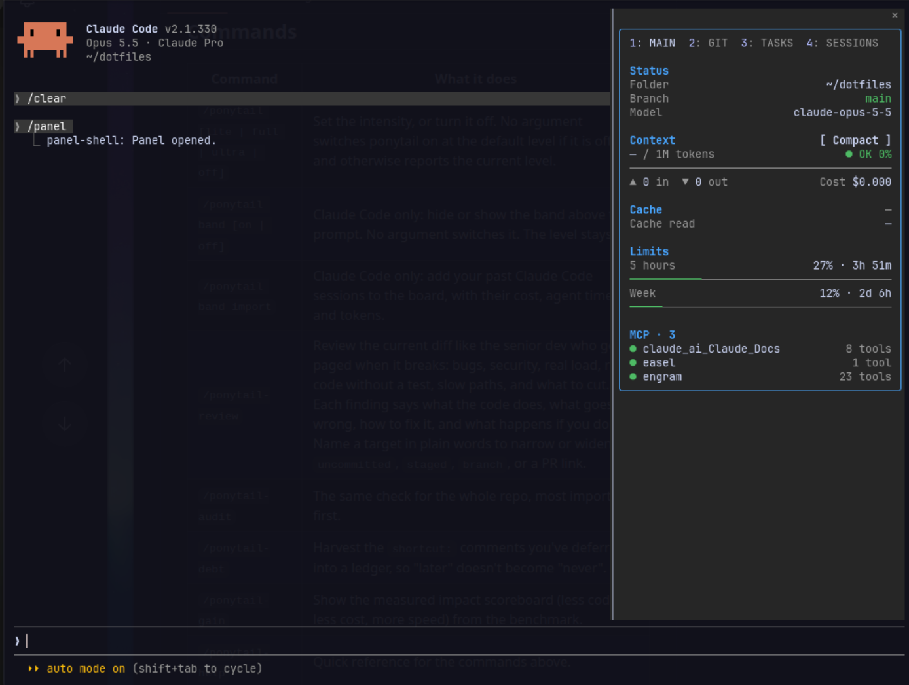
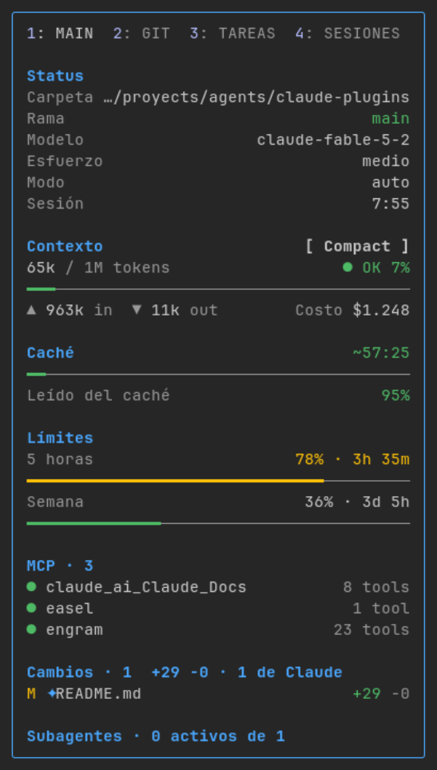
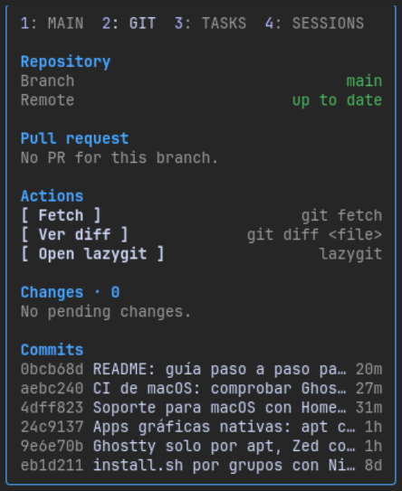
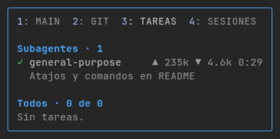
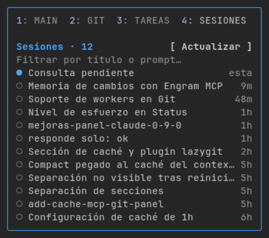

# claude-plugins

[English](../README.md) · **Español**

Mi marketplace personal de plugins para Claude Code.

Así se ve `panel-shell` al abrir Claude Code: el panel queda a la derecha de la conversación.



El detalle de cada una de sus cuatro pestañas:

<table>
  <tr><th>MAIN</th><th>GIT</th><th>TASKS</th><th>SESSIONS</th></tr>
  <tr>
    <td valign="top"></td>
    <td valign="top"></td>
    <td valign="top"></td>
    <td valign="top"></td>
  </tr>
</table>

## Instalar

### Opción A: en un solo paso

Desde la shell:

```bash
claude plugin install panel-shell --marketplace jonico22/claude-plugins
```

Si el marketplace todavía no está añadido, este comando lo añade primero (en la configuración de usuario) y después instala el plugin.

También puedes hacerlo desde el prompt de una sesión de Claude Code:

```
/plugin install panel-shell --marketplace jonico22/claude-plugins
```

Responde `y` para añadir el marketplace y elige el alcance.

### Opción B: en dos pasos

```bash
# 1. Añadir el marketplace (se registra con el nombre jonico22-plugins)
claude plugin marketplace add jonico22/claude-plugins

# 2. Instalar el plugin desde ese marketplace
claude plugin install panel-shell@jonico22-plugins
```

### Alcance

Por defecto se instala con alcance `user`, así que lo tienes en todas tus sesiones. Para limitarlo a un proyecto, usa `--scope`:

| Alcance | Dónde aplica |
|---|---|
| `user` (por defecto) | Todas tus sesiones |
| `project` | Este proyecto; se guarda en la configuración del repo y se comparte con el equipo |
| `local` | Este proyecto, solo en tu máquina |

```bash
claude plugin install panel-shell@jonico22-plugins --scope project
```

### Configurar al instalar

Puedes fijar las opciones del plugin al instalarlo:

```bash
claude plugin install panel-shell@jonico22-plugins --config color=morado
```

O después, con `/config` dentro de Claude Code o con `claude plugin configure panel-shell`.

### Comprobar la instalación

```bash
claude plugin list               # plugins instalados
claude plugin marketplace list   # marketplaces añadidos
```

Reinicia Claude Code para que cargue el plugin. El panel queda acoplado al lado del chat con el terminal en pantalla completa y al menos 110 columnas de ancho; si no, se abre encima del prompt.

### Probar en local (sin instalar)

Desde una copia del repositorio:

```bash
claude --plugin-dir plugins/panel-shell
```

## Actualizar

Cuando haya una versión nueva del plugin:

```bash
# 1. Traer la lista de plugins más reciente del marketplace
claude plugin marketplace update jonico22-plugins

# 2. Actualizar el plugin a la última versión
claude plugin update panel-shell@jonico22-plugins
```

Después **reinicia Claude Code** para que use la versión nueva. Con `claude plugin list` puedes ver qué versión tienes instalada.

Si lo instalaste con un alcance distinto de `user`, indícalo: `claude plugin update panel-shell@jonico22-plugins --scope project`.

`claude plugin marketplace update` sin nombre actualiza todos tus marketplaces.

**¿Lo tenías instalado como `panel-claude`?** El plugin se llamaba `panel-claude` hasta la 0.11.0. Para pasar al nombre nuevo, desinstala el anterior, actualiza el marketplace e instala `panel-shell`; las opciones de `/config` hay que volver a ponerlas:

```bash
claude plugin uninstall panel-claude@jonico22-plugins
claude plugin marketplace update jonico22-plugins
claude plugin install panel-shell@jonico22-plugins
```

## Desinstalar

```bash
claude plugin uninstall panel-shell@jonico22-plugins
# opcional: quitar también el marketplace
claude plugin marketplace remove jonico22-plugins
```

Para apagarlo sin desinstalarlo: `claude plugin disable panel-shell@jonico22-plugins` (y `enable` para volver a activarlo).

## Plugins

| Plugin | Qué trae |
|---|---|
| `panel-shell` | Panel lateral con cuatro pestañas (`1` MAIN, `2` GIT, `3` TASKS, `4` SESSIONS) que muestra el estado de la sesión y del repositorio junto al chat. [Qué muestra cada pestaña](#qué-muestra-panel-shell). |

### Qué muestra panel-shell

La interfaz del panel está en inglés: los nombres de pestañas, secciones, botones y avisos van en inglés y aquí se glosan en español.

#### MAIN

- **Status** (estado): carpeta, rama, modelo, esfuerzo, modo de permisos y duración de la sesión.
- **Context** (contexto): barra, tokens y costo (`Cost`). Junto al total, `(+$X)` es el costo del último turno entero (todas sus llamadas a la API, subagentes incluidos); se queda hasta que empieza el siguiente turno y se descarta tras `/resume` o `/clear`. Bajo el total, una línea tenue muestra el costo por modelo (por ejemplo `Opus 5.5 $1.20 · Sonnet 5.5 $0.30`), del más al menos caro. El costo de cada turno (subagentes incluidos) se atribuye en vivo al modelo que respondió; una sesión reanudada parte del último registro de costo de la transcripción. Omite los modelos de menos de $0.01 y se oculta si ninguno llega a un centavo. Si los subagentes gastaron $0.01 o más, termina con `(subagents $0.52)`.
- **Cache** (caché): cuenta regresiva y barra que pasa a naranja al 70 % y a roja al 90 %. Muestra el porcentaje leído del caché. Avisa en un toast antes de que venza.
- **Limits** (límites de uso): 5 hours, week y spend.
- **MCP:** los servidores; los que dejan de aportar herramientas salen en rojo.
- **Changes** (cambios): los archivos con cambios.
- **Subagents** y **To-dos** (subagentes y tareas): un resumen de ambos.
- **Compact:** botón para compactar el contexto.
- **Mode** (modo; normal, plan, bypass permissions...): es el modo de permisos. Se lee de la transcripción de la sesión, así que va un turno atrasado si lo cambias con shift+tab.
- **Effort** (esfuerzo; low, medium, high...): sale igual de la transcripción. Aparece tras la primera respuesta y va un turno atrasada si lo cambias con `/effort`.

#### GIT

Repositorio y rama:

- **Repository** (repositorio): la rama, los commits por subir y bajar (`Remote`) y los contadores de staged y unstaged.
- **Git se relee** tras cada edición de Claude.

Changes (cambios):

- **Archivos:** los renombrados salen con su ruta nueva. Cada uno lleva `+líneas −líneas`. Van agrupados en stage, sin stage y sin seguimiento (todos, con scroll).
- **Resumen del diff:** pulsa un archivo para verlo. `d` o el botón `View diff` abre el diff completo en una ventana aparte, con delta si lo tienes.
- **Archivos de Claude:** los que Claude editó en la sesión llevan una marca ✦. El título de Changes cuenta `N by Claude` (N de Claude). El botón `Claude only` (solo los de Claude, `o`) filtra la lista a esos.

Commits:

- Los últimos commits con su hora.

Actions (acciones):

- **`Fetch`** (`git fetch`, `f`).
- **`View diff`** (ver diff, `d`).
- **`Open lazygit`** (abrir lazygit, `l`): abre [lazygit](https://github.com/jesseduffield/lazygit) en una ventana de terminal nueva (o en un popup dentro de tmux).

Branches (ramas):

- Si hay más de una rama local, las lista por commit más reciente (las primeras 8) con cuánto van por delante o por detrás de su remota (`no upstream` o `upstream gone` si no tienen).

Pull request:

- **Requisito:** necesita [`gh`](https://cli.github.com/) con sesión iniciada; sin él no sale.
- **Qué muestra:** el PR de la rama, su estado, los checks de CI con los fallidos y pendientes por nombre y el botón `Open PR` (`p`).
- **Avisos y relecturas:** avisa con un toast cuando los checks terminan. Se relee al entrar a GIT, tras `Fetch`, tras un `git push` o `gh pr` de Claude y cada minuto mientras haya checks pendientes.

Worktrees:

- **Lista:** si el repo tiene varios, los lista con `±N` (archivos con cambios sin guardar, solo los primeros 8 y solo si N > 0), `locked` si están bloqueados y `missing` si su carpeta ya no está.
- **Abrir uno:** pulsarlo abre lazygit ahí. Los que ya no existen solo avisan con un toast.
- **`Prune`** (limpiar, `w`): ejecuta `git worktree prune`. Solo sale mientras haya algún worktree que ya no existe.

Stash:

- Lista los guardados con su mensaje y hace cuánto se hicieron (los primeros 8). Pulsa uno para ver un resumen de los archivos que contiene.

#### TASKS

- **Subagents** (subagentes): con tokens, costo (desde $0.01; aproximado si varios corren en paralelo) y duración. El título suma su costo total.
- **To-dos** (tareas): la lista completa.

#### SESSIONS

- **Sessions** (sesiones): las últimas sesiones de Claude Code en esta carpeta, con su título, su costo (si es mayor que cero) y hace cuánto se usaron. El título añade `today $X · 7d $Y`: el costo de las sesiones escaneadas según su fecha de modificación (solo las 30 más recientes, no todo el historial).
- **Detalle:** pulsa una para ver su último prompt, costo, duración y líneas cambiadas.
- **`Summarize`** (resumir, `s`): pide un resumen de 2 o 3 frases al modelo rápido. Lo escribe en el idioma de los prompts de la sesión, sea cual sea. Es una llamada pequeña que suma al costo. El resumen queda guardado.
- **`Resume`** (reanudar, `r`): abre la sesión con `claude --resume` en una ventana aparte.
- **Filtro:** el campo de arriba filtra por título, último prompt o resumen, sin distinguir mayúsculas ni acentos. Busca entre las 30 sesiones más recientes aunque solo se dibujen 12.
- **`Clear filter`** (borrar filtro, `x`): lo borra.

#### Abrir y configurar

- **Al iniciar:** el panel se abre solo.
- **Comandos:** `/panel` lo abre y `/panel close` lo cierra. Hay más detalle en [Comandos y atajos](#comandos-y-atajos-de-panel-shell).
- **`/config`:** ahí eliges el color, la duración del caché (por defecto la lee de `promptCacheTtl`), el aviso de vencimiento, la terminal de las ventanas (lazygit, `View diff` y `Resume`), qué secciones de MAIN se muestran si GIT muestra el Pull request (`showPr`), las notificaciones (`notify`) y cuánto debe durar un turno para ser largo (`notifyAfter`, 60 segundos por defecto). Otras formas de fijarlas, en [Configurar al instalar](#configurar-al-instalar).

#### Notificaciones

El panel también puede mandar notificaciones nativas (fuera del panel, para cuando estás en otra ventana). Su título es el de la sesión, o el nombre de la carpeta si no lo tiene. `notify` en `/config` elige cuáles:

- **`long`** (por defecto): solo cuando un turno del hilo principal dura más de `notifyAfter` segundos, como `Turn finished in 2m 05s ($0.42)`. Los turnos de subagentes y los cancelados no avisan.
- **`all`**: ese aviso más los checks del PR al terminar y el caché por vencer (solo si te alejaste de la sesión; se cancela al empezar un turno nuevo o al renovarse el caché).
- **`off`**: ninguna.

Si la terminal o el cliente no pueden mostrarlas, no pasa nada: el panel sigue funcionando.

### Comandos y atajos de panel-shell

Comandos:

| Comando | Qué hace |
|---|---|
| `/panel` | Abre el panel. |
| `/panel close` | Lo cierra. También vale `/panel off` (y `/panel cerrar`, que se mantiene por compatibilidad). |

Atajos de teclado. Cada uno es la tecla del botón con el mismo nombre:

| Tecla | Dónde funciona | Botón | Qué hace |
|---|---|---|---|
| `1` | Cualquier pestaña | MAIN | Va a la pestaña MAIN. |
| `2` | Cualquier pestaña | GIT | Va a la pestaña GIT y relee el PR. |
| `3` | Cualquier pestaña | TASKS | Va a la pestaña TASKS. |
| `4` | Cualquier pestaña | SESSIONS | Va a la pestaña SESSIONS y relee la lista. |
| `c` | MAIN, título Context | Compact | Compacta el contexto de la sesión. |
| `o` | GIT, título Changes | Claude only / All | Filtra la lista a los archivos que editó Claude, o la muestra entera. Solo sale si Claude editó alguno. |
| `p` | GIT, sección Pull request | Open PR | Abre el PR de la rama. Solo sale si la rama tiene PR. |
| `f` | GIT, sección Actions | Fetch | Ejecuta `git fetch`. |
| `d` | GIT, sección Actions | View diff | Abre el diff completo en una ventana aparte. |
| `l` | GIT, sección Actions | Open lazygit | Abre lazygit en una ventana de terminal nueva. |
| `w` | GIT, sección Worktrees | Prune | Ejecuta `git worktree prune`. Solo sale si algún worktree ya no existe. |
| `u` | SESSIONS | Refresh | Relee la lista de sesiones. |
| `x` | SESSIONS | Clear filter | Borra el texto del filtro. Solo sale si hay un filtro escrito. |
| `s` | SESSIONS, sesión abierta | Summarize / Summarize again | Pide un resumen de la sesión al modelo rápido. |
| `r` | SESSIONS, sesión abierta | Resume | Abre la sesión con `claude --resume` en una ventana aparte. Solo sale si no es la sesión actual. |

## Estructura

```
.claude-plugin/marketplace.json   lista de plugins
docs/img/                         capturas del README
docs/README.es.md                 este README en español
plugins/<nombre>/
  .claude-plugin/plugin.json      nombre, versión, descripción
  hooks/hooks.json                nombra el módulo de hooks
  hooks/register.tsx              el código del plugin
  types/index.d.ts                los datos que guarda el plugin
  tests/                          pruebas (claude plugin test <carpeta>)
```

## Publicar una versión nueva (para el mantenedor)

1. Sube `version` en `plugins/<nombre>/.claude-plugin/plugin.json` **y** en `.claude-plugin/marketplace.json`. Tienen que coincidir.
2. Valida los manifiestos:
   ```bash
   claude plugin validate .
   ```
3. Haz commit y crea la etiqueta. `claude plugin tag` comprueba que las dos versiones coinciden y crea la etiqueta `<nombre>--v<versión>` (por ejemplo `panel-shell--v0.2.0`):
   ```bash
   git commit -am "panel-shell 0.2.0"
   claude plugin tag plugins/panel-shell
   git push && git push --tags
   ```
4. Los usuarios la reciben siguiendo los pasos de [Actualizar](#actualizar).

## Requisitos

- Claude Code 2.1.322 o más nuevo. El plugin usa una API en acceso anticipado que puede cambiar entre versiones.
- `git`, para la rama, los cambios y los worktrees.
- `lazygit` (opcional), para el botón `Open lazygit` y para abrir un worktree.
- `gh` (opcional), para la sección Pull request y sus checks en la pestaña GIT.
